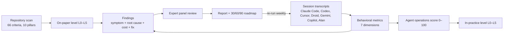

# The Agent Readiness Framework

Agent readiness is measured through two lenses:

- **On paper:** is the repository built so that an agent can succeed in it?
- **In practice:** do the agents your developers run actually succeed in it?

File-based scorecards, such as Factory's Agent Readiness report, only answer the first question. The second is where most of the cost hides.

The framework puts both lenses on one five-level scale. The gap between them tells a leadership team whether to invest in the codebase, in agent operations, or in both.

## The five levels

| Level | Name | What agents can do unattended |
|---|---|---|
| L0 | Not ready | Read the code. They cannot reliably build, run or verify it. |
| L1 | Functional | Make small edits. A human builds, runs and verifies every change. |
| L2 | Documented | Follow written conventions on scoped changes, with close review. |
| L3 | Standardized | Take a well-scoped task to a locally verified change. **This is the target for production agent use.** |
| L4 | Optimized | Deliver multi-file features with fast feedback and light review. |
| L5 | Autonomous | Take a spec to a tested, reviewed pull request. Humans provide strategic oversight only. |

## Lens 1: on paper (repository scan)

There are 66 pass/fail criteria. Each one records the file, script or configuration that proves its result. A criterion is **skipped** rather than failed when the checkout cannot measure it, for example when git history is missing from a shallow clone.

**Gating:** a level is reached when at least 80% of its criteria pass **and every lower level passes**. This stops a repository from collecting easy wins at L4 while L2 is still broken.

**Score:** the score (0–100) is the share of criteria passed, weighted by level, so an L5 criterion counts five times as much as an L1 criterion.

| Pillar | What it asks | Example criteria (level) |
|---|---|---|
| Agent Context & Instructions | Does an agent start a session knowing the stack, the commands and the rules? | Instruction file exists (1) · runnable commands documented (2) · high-risk invariants written down (3) · component-level instructions (4) · instructions for every harness in use (5) |
| Codebase Navigability | Can an agent find where a feature lives and read a whole unit? | Statically typed (1) · workspace map (2) · strict types, few files over 1,500 lines (3) · generated code marked, CODEOWNERS (4) |
| Environment Reproducibility | Can an agent start the app and its services in a fresh sandbox? | Lockfile (1) · pinned runtime, `.env.example` (2) · one-command setup, containerized services (3) · seed data (4) · cloud/devcontainer environment (5) |
| Testing & Verification | Can an agent prove its change works? | Tests and a test command (1) · type-check command (2) · focused per-package tests, healthy test ratio (3) · end-to-end tests (4) · coverage (5) |
| Static Guardrails | Do machines catch mistakes before people do? | Linter (1) · formatter, auto-fix (2) · pre-commit hooks (3) · architecture rules enforced as code (4) |
| CI/CD & Feedback Loops | Is every agent change independently verified, quickly? | CI exists (1) · runs on PRs (2) · runs tests and lint, PR template (3) · cached, automated deploys (4) · dependency bots (5) |
| Observability & Debuggability | Can an agent debug from evidence? | Structured logs (2) · error tracking, health checks (3) · test traces and screenshots (4) · runbooks (5) |
| Security & Governance | Is autonomy safe to grant? | No committed secrets (1) · guarded migrations (2) · destructive operations forbidden in writing (3) · committed agent permission policy, secret scanning (4) · security policy (5) |
| Task & Spec Discipline | Do tasks arrive with enough definition to be done right? | Definition of done (2) · API contracts, issue templates (3) · specs and plans in the repo (4) · changelog (5) |
| Agent Tooling & Integrations | Do agents have the tools developers have? | Harness config committed (2) · browser automation, team skills (3) · agent authentication to the app, MCP (4) · lifecycle hooks (5) |

The scanner implements the full catalogue in `scripts/repo_scan.py` (the `CRITERIA` table). Each entry carries the reason the criterion matters (`why`) and how to fix a failure (`fix`).

## Lens 2: in practice (session behavior)

Transcripts are parsed locally into provider-neutral events: user prompts, assistant messages, tool calls and tool results. Each tool call is classified as one of:

- read
- search
- code index
- edit, including shell edits such as heredocs, `sed -i` or `apply_patch`
- validate, at one of five depths: lint, type check, build, test, or end-to-end
- shell
- MCP
- delegate
- plan
- skill
- deliver (commit or PR)

### The seven behavioral dimensions

| Dimension | Question | Key metrics |
|---|---|---|
| **1. Codebase exploration** | How do agents study the codebase? | Tool calls and files read before the first edit · share of calls spent reading and searching · search-to-read ratio · code-index use · **blind edits** (modifying a file never opened in the session) · re-read churn · whether the agent opened the instruction file |
| **2. Workflow shape** | What path does work take from request to change? | Funnel: request → explored → changed → verified → delivered · session outcome mix · plan, sub-agent, skill and MCP use · longest autonomous run |
| **3. Verification discipline** | Do agents prove their work? | Share of code-changing sessions where a test, type check or build **passed after the final edit** (lint alone does not count) · depth distribution · completion claims without verification |
| **4. Side effects & disclosure** | What do agents do that the diff does not show? | High-risk actions per session (containers and databases started, shared dependencies or generated code changed, git history rewritten, hooks bypassed, data queried, secrets read, writes into other checkouts) · whether the agent's final report disclosed each one · lower-risk scratch writes counted separately |
| **5. Failure & recovery** | Where do agents get stuck? | Tool failure rate · failure taxonomy (missing dependency, service down, environment configuration, authentication, sandbox permission, timeout, type errors, test failures, wrong path, edit mismatch, network, git state, tool schema) · repeated identical failing commands · sessions ending on a failure |
| **6. Human-agent collaboration** | How do developers direct agents? | Who starts the work (typed by a developer, relayed from Slack or Teams, a workflow or orchestrator, a schedule) · first-prompt specificity (files, acceptance criteria, reproduction, verification step, ticket link) · request quality against outcome · corrections, interruptions, single-shot rate |
| **7. Instruction adherence** | Do agents follow the rules the team already wrote? | **Instruction reach:** does each harness in use load an instruction file? (Claude Code reads `CLAUDE.md`, not `AGENTS.md`) · share of verification commands that match documented commands · violations of written "never" rules found in commands and edit content |

### Session outcomes

Each session is classified into one outcome:

- **Verified delivery:** changed code, and a test, type check or build passed afterwards.
- **Unverified change:** changed code without passing verification.
- **Blocked:** the agent reported it could not proceed because of the environment or missing context.
- **Stuck in failure loops:** repeated failing commands made up a large share of the calls.
- **Exploration or Q&A.**
- **Ops and environment work.**
- **Scheduled automation.**
- **Conversation only.**

### Agent operations score and in-practice level

| Component | Weight | Computed as |
|---|---|---|
| Verified delivery | 25% | % of code-changing sessions verified after the final edit |
| Unblocked sessions | 15% | 100 − % of sessions that were blocked or stuck |
| Safe operation | 15% | 100 − % of sessions with a high-risk side effect (containers or databases started, shared state changed, history rewritten, hooks bypassed, data queried, writes into other checkouts) |
| Tool reliability | 15% | 100 − 4 × tool failure rate |
| Request quality | 15% | 100 − % of vague first prompts |
| Grounded edits | 5% | 100 − % of code-changing sessions with blind edits |
| Low rework | 10% | 100 − 2 × % of sessions needing a correction |

The score maps to a level: L1 at 25 or above, L2 at 45, L3 at 65, L4 at 80 and L5 at 90.

## Findings

Every finding pairs four things:

1. **Symptom:** what agents did, with transcript excerpts.
2. **Root cause:** the failing repository criteria that explain it.
3. **Impact and cost.**
4. **Fix:** concrete steps plus the matching Alan playbook, with an effort estimate (S, M or L) and a horizon (30, 60 or 90 days).

| Finding | Triggered when |
|---|---|
| Instruction reach | A harness in use has no instruction file it loads |
| Environment blockers | Sessions blocked, or failures of the service, configuration or dependency class |
| Verification gap | Fewer than 85% of code-changing sessions were verified after the final edit |
| Instruction drift | Fewer than 70% of verification commands match the docs, or written rules were broken |
| Vague prompts | At least 25% of first prompts carry one specificity signal or none |
| Exploration cost | Median orientation of 15 or more calls, under 10% code-index use, or at least 30% of sessions with blind edits |
| Failure loops | Repeated identical failing commands, or a tool failure rate of 12% or more |
| Corrections | At least 15% of sessions needed a correction |
| Orchestration | Less than 20% of agent runs started by workflows or schedules |
| No reuse | Plan and skill use both under 20% |
| Level blockers | The failing criteria that stand between the repository and its next level |

### Cost model

The cost model is deliberately transparent. Every input is printed in the report and can be overridden:

> minutes lost per session = blocked share × (median session + 15-minute handoff) + unverified share × 20 minutes of extra review + wasted calls × 0.5 minutes + corrections × 4 minutes

Weekly hours lost are then: minutes lost per session × sessions per developer per week (default 15) × developers (default 25) ÷ 60.

## Expert panel

Before delivery, four independent AI reviewers challenge the findings:

- **The Buyer:** credibility to an executive.
- **The Auditor:** recomputes metrics from the raw transcripts and hunts analyzer bugs.
- **The Security Lead:** risky agent actions, and whether the report surfaces them.
- **The Platform Lead:** whether root causes and fixes are right and correctly sequenced.

A moderator then reconciles the reviews. Confirmed analyzer bugs are fixed in code and the assessment is re-run. Severities and caveats change only on evidence, and the panel's verdict, disagreements and adjustments are printed in the report. The protocol is in `references/panel.md`.

## What makes this different

| | File-based scorecards | This framework |
|---|---|---|
| Measures repository structure | Yes | Yes (66 criteria, 80% gating) |
| Measures what agents actually do | No | Yes: exploration, verification, failures, adherence |
| Measures how developers direct agents | No | Yes: who starts the work, request quality against outcome, corrections |
| Checks that instructions reach every harness | No | Yes |
| Links each symptom to its root cause | No | Yes: every finding cites failing criteria |
| Prices the friction | No | Yes: a transparent cost model |
| Adversarial review before delivery | No | Yes: expert panel |
| Re-measures progress | Re-scans files | Re-runs on new sessions, with weekly targets |

## Limits

- Small samples are directional. Below 30 tool-level sessions, the report labels its findings as such.
- Dialogue-only exports (no tool events) feed only the collaboration dimension.
- Specificity, correction and "blocked" detection are pattern-based. The expert panel spot-checks them against raw transcripts.
- The cost model estimates the friction it can observe. It does not estimate value delivered.
